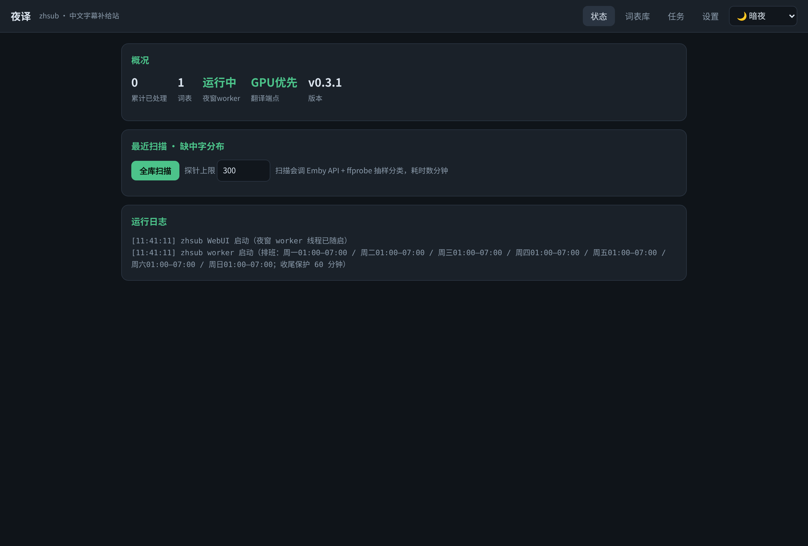
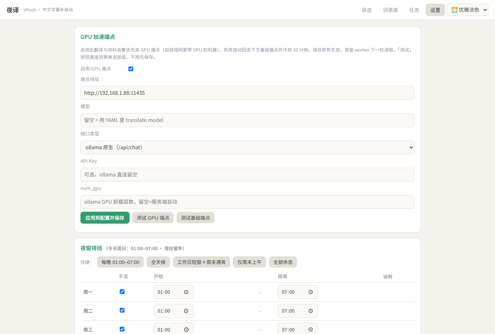
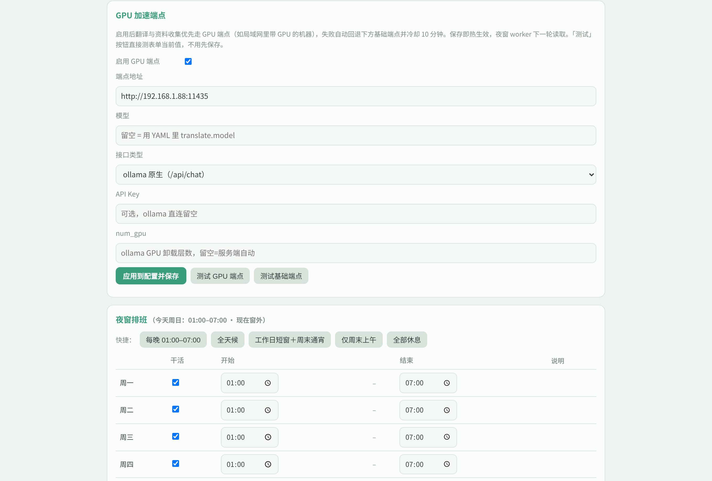
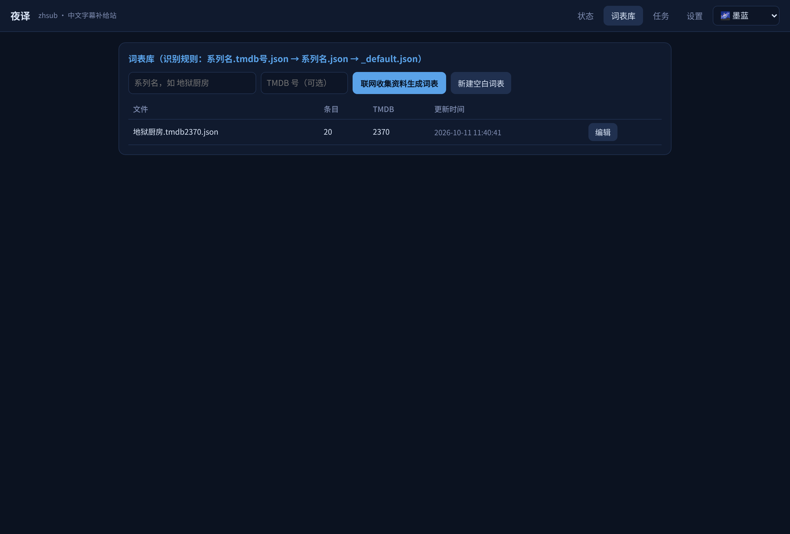

# 夜译 zhsub

**夜译** = 在**夜**窗里为影音库**译**补字幕。**zhsub** = **zh**(中文) + **sub**(字幕)：
给家庭媒体库自动补齐中文字幕的无头（headless）服务。

> Scan your media library for videos missing Chinese subtitles, extract embedded
> tracks when available, otherwise translate existing subtitles with a local LLM,
> and drop `.zh.ai.srt` next to your media/strm files. Emby/Jellyfin picks them up
> as regular external subtitles — no plugin, no cloud, no risk.
>
> **English**: *夜译 ("Night-shift Translate")* is a headless service that fills missing
> Chinese subtitles for home media libraries: it scans Emby/Jellyfin, extracts embedded
> Chinese tracks, translates foreign subtitles with a local LLM (Ollama native or any
> OpenAI-compatible endpoint, GPU-first with automatic fallback), builds per-series
> glossaries via TMDB/web research, and writes `*.zh.ai.srt` next to your media/strm
> files on a configurable nightly schedule. Documentation is Chinese-only for now.

## 截图

| 状态 · 暗夜 | GPU 端点 + 夜窗排班 · 优雅淡色 |
|---|---|
|  |  |
|  |  |
>
> Night-shift Chinese subtitle filler for home media libraries.

它解决一个问题：**库里的视频没有中文字幕时，自动补上。**

```
┌─────────┐  缺中字清单   ┌──────────────────────────────────────┐
│  Emby   │ ───────────▶ │ zhsub (Docker, 常驻)                  │
│ 媒体库  │              │                                      │
└─────────┘              │  ① 内嵌中字轨 → 直接抽取 (ffmpeg)      │
                         │  ② 内嵌英字轨 → 本地 LLM 翻译 (ollama) │
┌─────────┐  媒体文件     │  ③ 无文本轨(如PGS) → ASR（规划中）      │
│ 本地镜像 │ ◀─────────── │                                      │
│ /strm树 │              │  产物: xxx.zh.ai.srt / xxx.chi.srt    │
└─────────┘              └──────────────────────────────────────┘
```

## 特性

- **媒体库感知**：通过 Emby API 扫描指定媒体库，精确列出「哪些视频缺中文字幕」（按库、按剧统计），也可纯文件系统扫描（不依赖 Emby）。
- **三级处理链**：内嵌中文字幕直接抽取（带"空壳轨"校验）→ 内嵌英文字幕走本地大模型翻译 → 无文本轨留给 ASR（规划中）。
- **翻译前资料收集**：遇到没词表的新剧，先用本地 qwen 联网收集译名资料（TMDB 官方中文数据 + DuckDuckGo 搜索，支持 HTTP 代理配置），自动生成该剧词表再开翻。
- **词表库**：每剧一个 JSON，按「系列名 + TMDB 号」识别；翻译时注入 system prompt 保证人名/术语一致。老格式平铺词表直接拷入即用。
- **翻译质量保障**：批次翻译 + 行号对齐 + 单行降级；上下文窗口保持人名/语气连贯；指数退避重试。
- **GPU 加速端点**：`translate.gpu` 可配第二个推理端点（ollama 原生或 OpenAI 兼容 /v1），优先走 GPU、失败自动回退基础端点（冷却 10 分钟防雪崩）；WebUI 设置页表单配置 + 一键连通性测试。
- **WebUI**：状态/日志、触发扫描与处理、词表库在线编辑、GPU 端点与夜窗排班可视化配置、多套皮肤（暗夜/优雅淡色/墨蓝/青瓷，记忆选择），配置热生效（仅面向家庭内网，无鉴权，勿暴露公网）。
- **为 strm 库设计**：识别 `.strm` 内容路径并映射到本地镜像，产物写在 strm 树里，Emby 直接捡取，**全程不触碰网盘云端**。
- **夜窗排班**：worker 只在排班窗口内干活。支持统一窗口 + 按周一到周日分日设置（`schedule.windows`，可跨零点、可设某天休息）、每日常用组合的快捷预设；「收尾保护」距窗口结束 N 分钟不再开新集。WebUI 设置页可视化排班，保存即热生效。
- **无头运行**：单个容器，SQLite 记账，断点续跑。

## 快速开始

```bash
git clone https://github.com/montrush/zhsub.git
cd zhsub
cp config.example.yaml config/config.yaml   # 按注释填你的 Emby 地址/key、ollama 地址、代理
mkdir -p config data
docker compose up -d
```

浏览器打开 `http://NAS:8085`：**设置**页填代理/TMDB key → **状态**页点「全库扫描」→ **词表库**页给要翻的剧生成词表 → **任务**页试跑几集。夜窗 worker 会在配置时段自动处理。

先手动跑一次全库扫描看结果（不用等夜窗）：

```bash
docker compose exec zhsub zhsub scan          # 扫描 Emby，输出缺中字清单+统计
docker compose exec zhsub zhsub research --series 地狱厨房 --tmdb 2370   # 给某剧收集译名资料
docker compose exec zhsub zhsub run --limit 3 # 试处理 3 个（加 --dry-run 只看不做）
```

也可以不用 Docker：

```bash
pip install .                 # 需要 ffmpeg 在 PATH 中
zhsub web                     # WebUI + 夜窗 worker（--no-worker 只起 WebUI）
zhsub scan --config myconfig.yaml
```

## 配置

见 [`config.example.yaml`](config.example.yaml)，要点：

| 配置 | 说明 |
|---|---|
| `emby.*` | Emby 地址、API key、要扫描的媒体库（名称或 ItemId） |
| `paths.strm_roots` | 本地 strm/媒体树（容器内读写） |
| `paths.path_map` | strm 文件内容路径 → 本地镜像路径的前缀映射 |
| `paths.emby_path_map` | Emby 条目 Path → 本地路径的前缀映射 |
| `paths.glossary_dir` | 词表库目录：`<剧名>.tmdb<号>.json`，格式见 [`glossaries/README.md`](glossaries/README.md) |
| `translate.*` | 基础端点（ollama 地址、模型名、批大小、上下文窗口）；`translate.gpu.*` GPU 加速端点（enabled/base_url/model/provider/api_key/num_gpu），启用后优先 GPU、失败回退 |
| `research.*` | 资料收集：`proxy`（搜索/TMDB 走的 HTTP 代理）、`tmdb_api_key`、搜索后端 |
| `schedule.*` | `window` 统一窗口；`windows` 分日覆盖（mon..sun，可跨零点/休息）；`last_fire_min` 收尾保护分钟数 |
| `web.*` | WebUI 监听地址/端口、是否随启夜窗 worker |

### 字幕产物命名

| 来源 | 产物 | Emby 显示 |
|---|---|---|
| 内嵌中字轨抽取 | `视频名.default.chi.zh-cn.srt` | 中文（默认） |
| LLM 翻译 | `视频名.zh.ai.srt` | 中文（AI） |

两个名字都是历史延续，方便从旧管线无迁移过渡。

## 与 MoviePilot AutoSubv2 插件的关系

zhsub 是该插件的**独立重写**：把"住在 MP 插件框架里"的抽取/翻译逻辑搬进独立容器，
从此不再有补丁自愈、marketplace payload 重放覆盖、settle 期 reload 杀任务等问题。
翻译 prompt、批翻译/对齐/降级策略、空壳轨校验、夜窗/批次/卡死兜底参数均原样平移自
实战验证过的旧管线（driver v5 + patches v3）。迁移路径：zhsub 跑稳后停用旧插件即可，
Emby 侧零改动。

## Roadmap

- [x] WebUI（状态/任务/词表库/配置热生效）
- [x] GPU 加速端点（translate.gpu：GPU 优先 + 自动回退 + WebUI 表单/连通性测试）
- [ ] ASR 兜底（PGS 图形轨/无字幕轨，对接 faster-whisper 通路）
- [x] 联网资料收集 + 词表库（TMDB/搜索，代理可配）
- [ ] MoviePilot 联动：入库 webhook 即时处理新集（现在靠定时扫描）
- [ ] WebUI 加鉴权选项

## License

[MIT](LICENSE)
